# Lab Active Directory, segmentation réseau et PowerShell

Suite du [lab pfSense en haute disponibilité](https://github.com/richardlamahfr/lab-infra-pfsense-haute-disponibilite). Le réseau unique du départ est découpé en trois zones de sécurité filtrées par la paire pfSense : un LAN pour les postes et l'annuaire, une DMZ pour le serveur web exposé et une zone dédiée au serveur de fichiers. Ce socle accueille ensuite l'automatisation Active Directory en PowerShell.

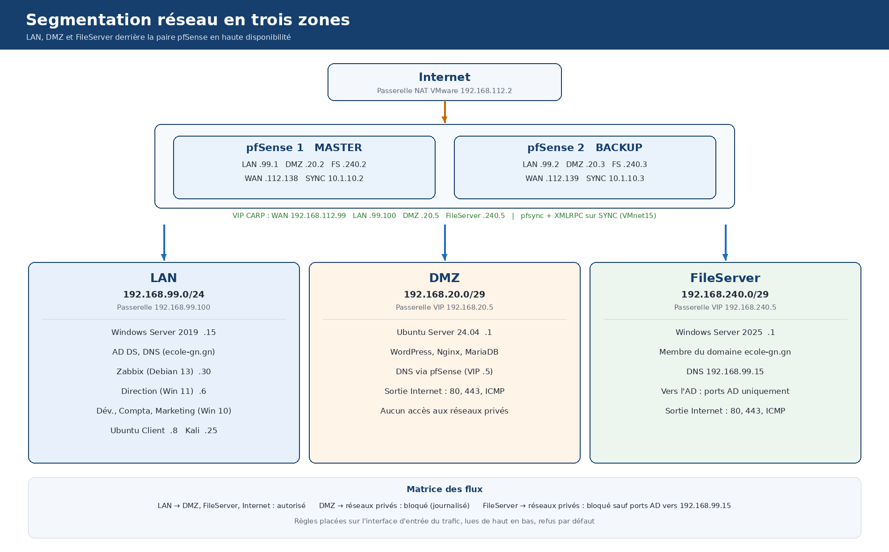

## Compétences mises en œuvre

- **Segmentation réseau** : trois zones derrière une paire pfSense CARP, une VIP passerelle par zone, NAT sortante de chaque zone sur la VIP WAN
- **Filtrage** : règles par interface d'entrée, alias (réseaux privés, ports web, ports Active Directory), refus par défaut, journalisation des blocages
- **Active Directory** : serveur Windows Server 2025 dans une zone dédiée, joint au domaine `ecole-gn.gn` à travers le pare-feu avec uniquement les ports AD ouverts
- **Méthode** : preuve du défaut avant correction, tests de non-régression après correction

## Plan d'adressage

| Zone | Réseau | Passerelle (VIP CARP) | pfSense 1 / 2 | Machines |
|---|---|---|---|---|
| LAN | 192.168.99.0/24 | 192.168.99.100 | .1 / .2 | AD et DNS (WS2019) .15, Zabbix .30, postes |
| DMZ | 192.168.20.0/29 | 192.168.20.5 | .2 / .3 | Ubuntu Server 24.04 (WordPress) .1 |
| FileServer | 192.168.240.0/29 | 192.168.240.5 | .2 / .3 | Windows Server 2025 .1 |
| WAN | 192.168.112.0/24 | Passerelle NAT 192.168.112.2 | .138 / .139 | VIP de sortie 192.168.112.99 |

Un /29 offre six adresses utilisables : le serveur, les deux pfSense et la VIP en occupent quatre. C'est suffisant pour une zone à un seul serveur et cela limite la surface d'adressage.

**Postes du domaine** : Direction sous Windows 11, Développement, Comptabilité et Marketing sous Windows 10. Les nouveaux postes reçoivent leur adresse du serveur DHCP du contrôleur de domaine (plage 192.168.99.55 à 192.168.99.70) ; le poste Marketing (PLT-001-Marketing) est passé en DHCP.

## Matrice des flux

| Source ↓ / Destination → | LAN | DMZ | FileServer | Internet |
|---|---|---|---|---|
| **LAN** | — | Autorisé | Autorisé | Autorisé |
| **DMZ** | **Bloqué**, sauf agent Zabbix vers 192.168.99.30:10051 | — | **Bloqué** | HTTP, HTTPS, ICMP |
| **FileServer** | Ports AD vers 192.168.99.15 uniquement | **Bloqué** | — | HTTP, HTTPS, ICMP |

Le DNS de la DMZ passe par pfSense (VIP 192.168.20.5) ; celui de FileServer par le contrôleur de domaine.

## Règles pfSense

**Principe** : une règle se place sur l'onglet de l'interface par laquelle le trafic **entre** dans le pare-feu. Les règles sont lues de haut en bas, la première qui correspond s'applique, tout le reste est refusé.

**Alias**

| Nom | Contenu |
|---|---|
| `RESEAUX_PRIVES` | 10.0.0.0/8, 172.16.0.0/12, 192.168.0.0/16 |
| `PORTS_WEB` | 80, 443 |
| `PORTS_AD` | 53, 88, 123, 135, 389, 445, 464, 636, 3268, 3269, 49152 à 65535 |

**Onglet DMZ**

| # | Action | Proto | Source | Destination | Port |
|---|---|---|---|---|---|
| 1 | Pass | TCP/UDP | DMZ subnets | This Firewall (self) | 53 |
| 2 | Pass | TCP | DMZ subnets | 192.168.99.30 (Zabbix) | 10051 |
| 3 | Block, journalisé | any | DMZ subnets | RESEAUX_PRIVES | * |
| 4 | Pass | TCP | DMZ subnets | any | PORTS_WEB |
| 5 | Pass | ICMP | DMZ subnets | any | * |

**Onglet FILESERVER**

| # | Action | Proto | Source | Destination | Port |
|---|---|---|---|---|---|
| 1 | Pass | TCP/UDP | FILESERVER subnets | 192.168.99.15 | PORTS_AD |
| 2 | Block, journalisé | any | FILESERVER subnets | RESEAUX_PRIVES | * |
| 3 | Pass | TCP | FILESERVER subnets | any | PORTS_WEB |
| 4 | Pass | ICMP | FILESERVER subnets | any | * |

Captures des règles en place : [onglet DMZ](docs/images/tests/09-regles-dmz.png) (avant correction de l'adresse Zabbix) et [onglet FILESERVER](docs/images/tests/10-regles-fileserver.png).

**NAT sortante** (mode Hybrid) : LAN subnets, 192.168.20.0/29 et 192.168.240.0/29 traduits vers la VIP WAN 192.168.112.99, pour que les connexions de chaque zone survivent à une bascule.

## Tests de validation (21 octobre 2026)

| ID | Test | Résultat attendu | Résultat obtenu |
|---|---|---|---|
| SEG 00 | Avant correction : DMZ vers AD, ports 445 et 389 | Doit être bloqué | **Défaut constaté** : connexions réussies |
| SEG 01 | Après correction : DMZ vers AD, port 445 | Bloqué | **Réussi** : connexion expirée (timed out) |
| SEG 02 | DMZ : résolution DNS et HTTPS vers Internet | Réponse HTTP | **Réussi** : HTTP/2 200 |
| SEG 03 | FileServer vers serveur web DMZ, port 80 | Bloqué | **Réussi** : TcpTestSucceeded False |
| SEG 04 | FileServer vers AD, port 389 | Autorisé | **Réussi** : TcpTestSucceeded True |
| SEG 05 | FileServer membre du domaine | Canal sécurisé valide | **Réussi** : Test-ComputerSecureChannel True |
| SEG 06 | Blocages visibles dans les journaux pfSense | Lignes Block DMZ vers LAN | **Réussi** : 192.168.20.1 vers 192.168.99.15:445 bloqué par la règle journalisée |
| SEG 07 | Supervision du serveur web en DMZ | Hôte joignable dans Zabbix | **Réussi** : ZBX au vert sur 192.168.20.1 |

**Avant correction, la DMZ joignait le contrôleur de domaine :**

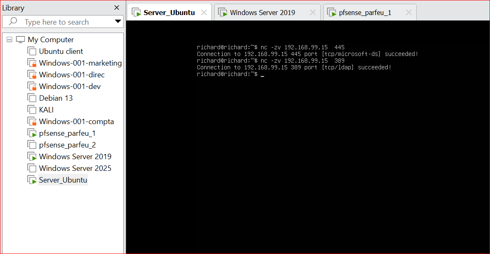

**Après correction, la DMZ ne joint plus le contrôleur de domaine, et le blocage est journalisé :**

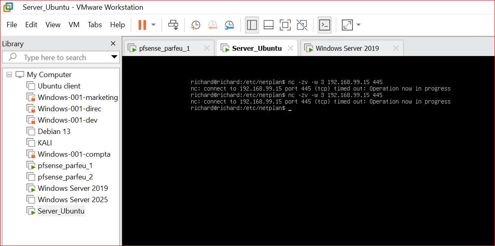

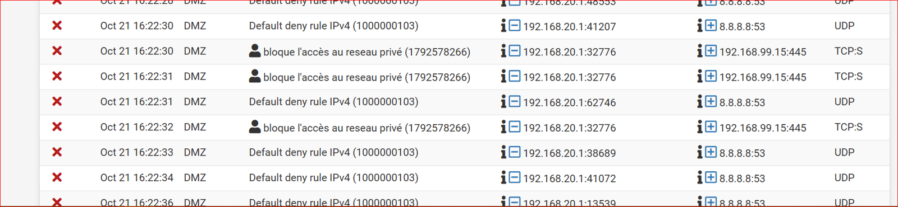

**Après correction, FileServer ne joint plus la DMZ mais joint toujours l'AD :**

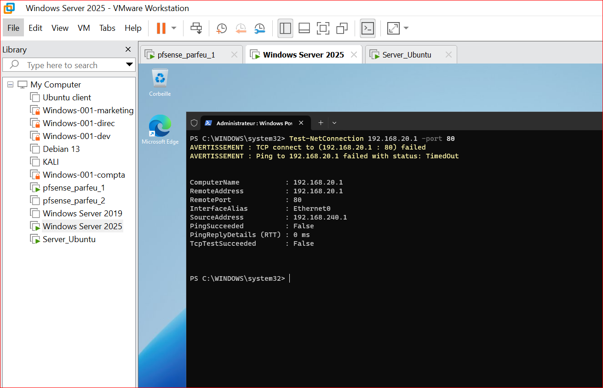

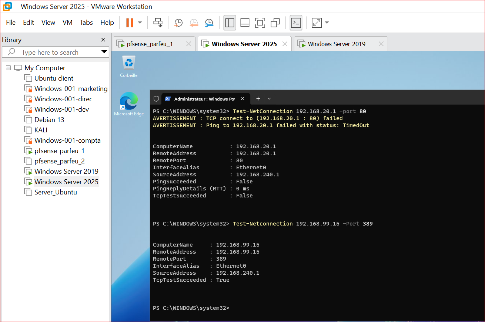

**La DMZ résout les noms par pfSense et sort en HTTPS :**

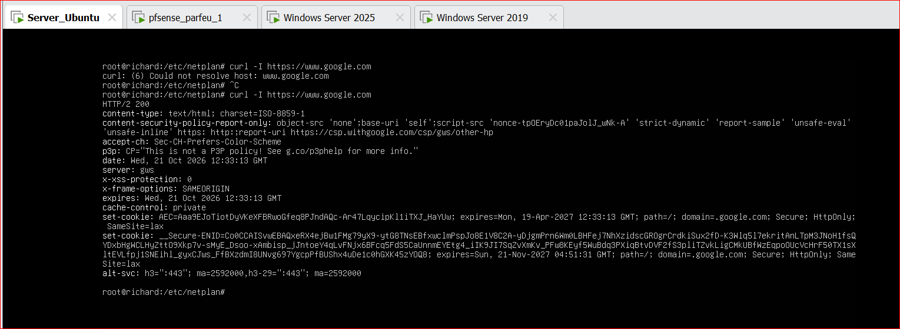

**FileServer est bien membre du domaine :**

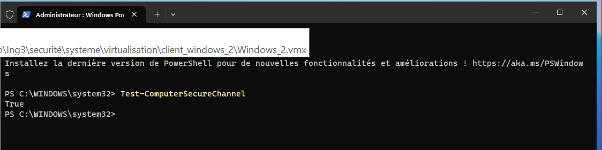

## DHCP sur le contrôleur de domaine

Le serveur DHCP de pfSense est désactivé sur le LAN : un seul serveur DHCP par réseau, le rôle DHCP de Windows Server 2019 (192.168.99.15).

| Paramètre | Valeur |
|---|---|
| Étendue | 192.168.99.0/24 |
| Plage distribuée | 192.168.99.55 à 192.168.99.70 (16 adresses, hors adresses fixes, VIP et plage sans Internet) |
| 003 Routeur | 192.168.99.100 (VIP CARP) |
| 006 Serveurs DNS | 192.168.99.15 uniquement |
| 015 Nom de domaine DNS | ecole-gn.gn |

| ID | Test | Résultat attendu | Résultat obtenu |
|---|---|---|---|
| DHCP 01 | Bail obtenu par un poste du LAN | Adresse dans la plage, serveur 192.168.99.15 | **Réussi** : 192.168.99.55 |
| DHCP 02 | Passerelle distribuée | 192.168.99.100 | **Réussi** après correction |
| DHCP 03 | DNS distribué | 192.168.99.15 seul | **Réussi** après correction |
| DHCP 04 | Accès Internet et résolution du domaine depuis le poste | `ping 8.8.8.8` et `nslookup ecole-gn.gn` répondent | **Réussi** : 0 % de perte, ecole-gn.gn résolu en 192.168.99.15 |
| DHCP 05 | Serveur DHCP autorisé dans l'AD | `Get-DhcpServerInDC` liste 192.168.99.15 | **Réussi** : wn-server.ecole-gn.gn autorisé |

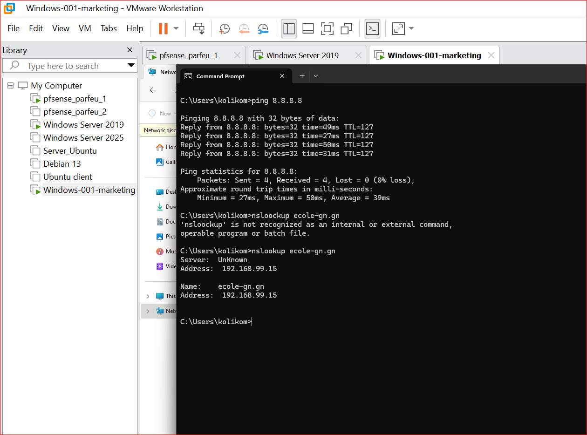

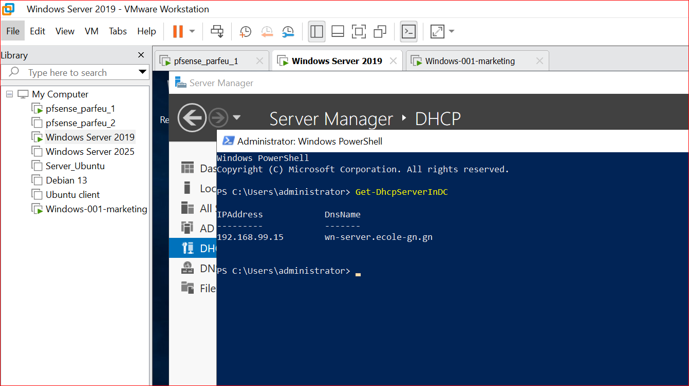

*Remarque : `nslookup` affiche « Server: UnKnown » car il n'existe pas encore de zone de recherche inversée (192.168.99.x) pour retrouver le nom du serveur DNS à partir de son adresse. Création prévue.*

## Automatisation Active Directory en PowerShell

Le script [`scripts/New-LabADStructure.ps1`](scripts/New-LabADStructure.ps1) s'appuie sur l'arborescence `Site_Paris` et la complète à partir de deux fichiers :
- [`scripts/utilisateurs.csv`](scripts/utilisateurs.csv) : 30 utilisateurs fictifs (Direction 3, RH 3, Développement 8, Comptabilité 6, Marketing 10) ;
- [`scripts/ordinateurs.csv`](scripts/ordinateurs.csv) : les 4 postes du domaine et leur service.

```
ecole-gn.gn
└── OU Site_Paris
    ├── OU Admin            comptes d'administration de l'infrastructure (séparés des utilisateurs)
    ├── OU Comptabilite
    │   ├── OU users        utilisateurs du service
    │   └── OU computers    postes du service (LAT-001-COMPT)
    ├── OU Developpement    (users, computers : LAP-001-DEV)
    ├── OU Direction        (users, computers : LAT-001-DIREC)
    ├── OU Marketing        (users, computers : PLT-001-MARKETI)
    ├── OU RH               (users, computers)
    ├── OU Groupes          GRP_Comptabilite, GRP_Developpement, GRP_Direction, GRP_Marketing, GRP_RH
    └── OU Serveurs         FILESERVER (Windows Server 2025)
```

**Pourquoi déplacer les postes** : `Computers` et `Users` sont des conteneurs par défaut, pas des OU. On ne peut pas y lier de GPO ; les postes doivent donc être rangés dans une OU pour recevoir des stratégies ordinateur.

**Choix de conception**

| Choix | Raison |
|---|---|
| Organisation par service, puis par type d'objet (`users`, `computers`) | Une GPO liée à `Site_Paris` touche toute l'entreprise, une GPO liée à `Marketing\computers` seulement les postes du Marketing |
| Comptes d'administration dans une OU `Admin` distincte | Leur appliquer des règles plus strictes et ne jamais les mélanger aux comptes du quotidien |
| Identifiant `prenom.nom`, sans accents, 20 caractères maximum | Limite du sAMAccountName ; « Hélène Martin » devient `helene.martin` |
| Suffixe numérique en cas d'homonyme | Deux « Mamadou Diallo » donnent `mamadou.diallo` puis `mamadou.diallo2` |
| Mot de passe demandé à l'exécution, seulement si un compte doit être créé ; changement obligatoire à la première connexion | Aucun mot de passe écrit dans le script ni dans le dépôt ; une relance ou une simulation ne le demande pas |
| Script idempotent | Un objet existant ou déjà à sa place est ignoré : le script peut être relancé sans erreur |
| Prise en charge de `-WhatIf` | Simulation complète avant toute modification de l'annuaire |
| OU créées protégées contre la suppression accidentelle | Bonne pratique Active Directory |
| Journal horodaté de chaque exécution | Traçabilité des opérations |

**Utilisation**, sur le contrôleur de domaine, dans une console PowerShell en administrateur. Le script se récupère directement depuis ce dépôt :

```powershell
New-Item C:\Scripts -ItemType Directory -Force | Out-Null
$base = "https://raw.githubusercontent.com/richardlamahfr/lab-ad-segmentation-powershell/main/scripts"
"New-LabADStructure.ps1","utilisateurs.csv","ordinateurs.csv" | ForEach-Object { Invoke-WebRequest "$base/$_" -OutFile "C:\Scripts\$_" }
cd C:\Scripts
.\New-LabADStructure.ps1 -WhatIf     # 1. simulation
.\New-LabADStructure.ps1             # 2. exécution réelle
.\New-LabADStructure.ps1             # 3. relance : tout doit être ignoré
```

| ID | Test | Résultat attendu | Résultat obtenu (25 octobre 2026) |
|---|---|---|---|
| PS 01 | Simulation `-WhatIf` | Liste des opérations, aucune modification | **Réussi** : OU Groupes, 5 groupes, 29 utilisateurs et 4 postes annoncés, 0 erreur |
| PS 02 | Exécution réelle | OU Groupes, 5 groupes, utilisateurs créés, 4 postes déplacés, 0 erreur | **Réussi** : 29 créés, 1 ignoré (compte existant `mamadoud`), 4 postes déplacés, 0 erreur, en 3 secondes |
| PS 03 | Relance | Tout est ignoré, 0 erreur | **Réussi** : OU, groupes et utilisateurs signalés « déjà présents » |
| PS 04 | Contrôle dans l'annuaire | Groupes de 6, 8, 3, 10 et 3 membres ; conteneur `Computers` vide | **Réussi** : GRP_Comptabilite 6, GRP_Developpement 8, GRP_Direction 3, GRP_Marketing 10, GRP_RH 3 ; `Computers` vide |
| PS 05 | Première connexion d'un compte créé | Changement de mot de passe imposé | **Réussi** : `camille.lefebvre` doit changer son mot de passe sur le poste Marketing |

**Total dans `Site_Paris` : 38 comptes.** Les 30 du CSV, plus 8 comptes créés manuellement avant le script, qui ne sont pas gérés par lui. Le compte `mamadoud`, déjà présent, a été reconnu par son prénom et son nom : le script n'a pas créé de doublon. Il a ensuite été rangé dans `Direction\users` et ajouté à `GRP_Direction`. Le serveur de fichiers `FILESERVER` a été placé dans une OU `Serveurs` dédiée : un serveur ne reçoit pas les mêmes GPO qu'un poste de travail.

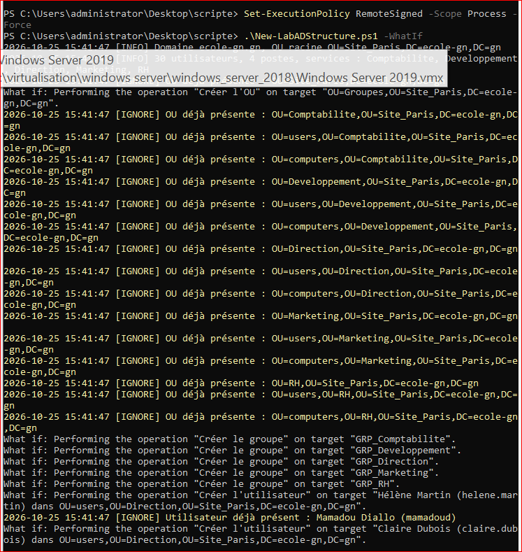

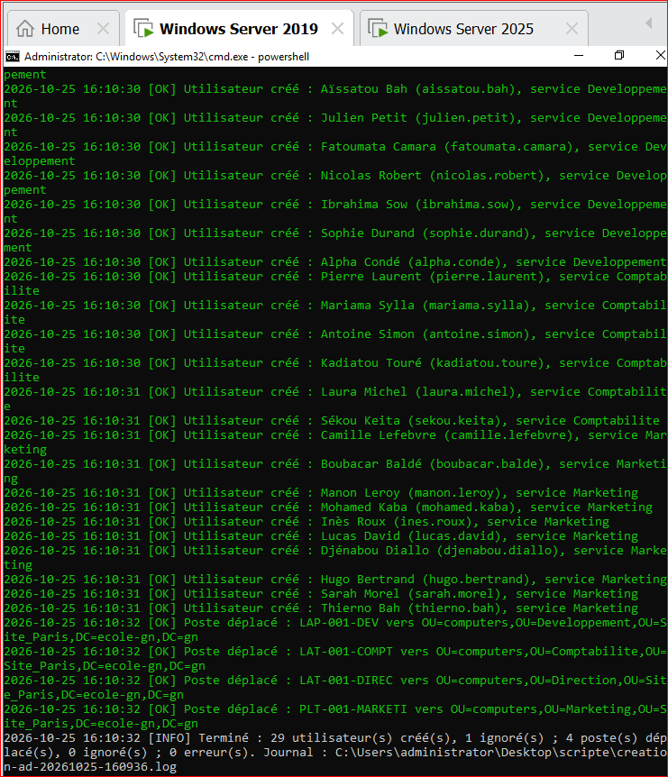

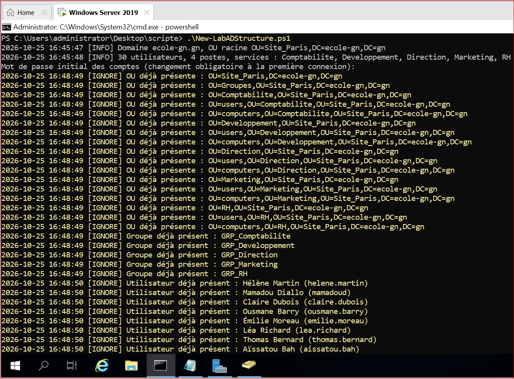

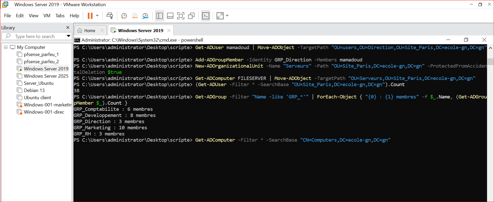

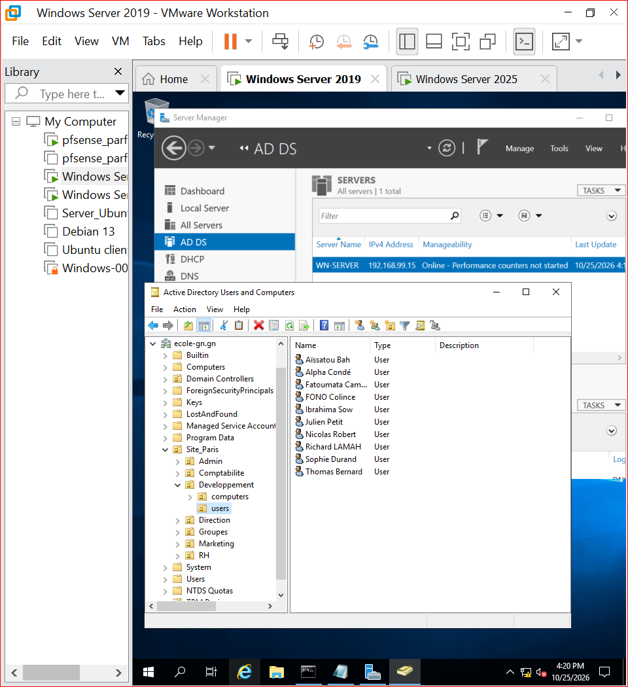

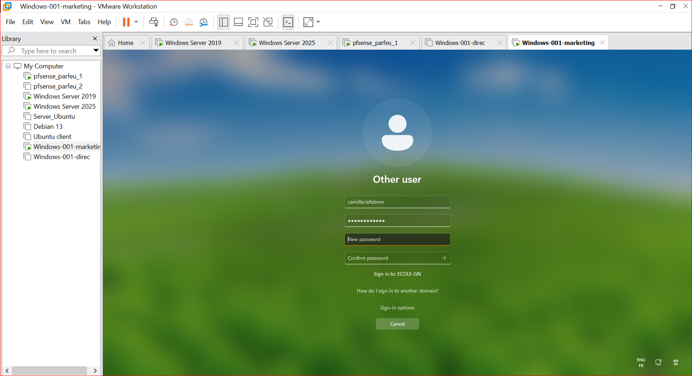

Journal complet de l'exécution réelle : [`docs/journaux/creation-ad-20261025-160936.log`](docs/journaux/creation-ad-20261025-160936.log). Il ne contient aucun mot de passe.

## Problèmes rencontrés et solutions

### 1. Aucune communication avec les nouvelles zones : « Block private networks »

**Symptôme** : après la création de la DMZ, les machines de la zone ne communiquaient pas à travers pfSense.

**Cause** : l'option *Block private networks and loopback addresses* était cochée sur l'interface. Elle bloque toute source en adresse privée (RFC 1918). Elle est prévue pour une interface WAN face à Internet, d'où aucune adresse privée ne doit arriver ; sur une zone interne, dont les adresses sont elles-mêmes privées, elle bloque tout.

**Résolution** : après plusieurs vérifications et tentatives, identification de l'option en cause dans la configuration de l'interface, puis décochage. Le WAN du lab (192.168.112.0/24, derrière le NAT VMware) étant lui aussi privé, l'option y est également désactivée.

**Ce que j'en retiens** : une option de sécurité se comprend avant de se cocher ; son libellé précise d'ailleurs qu'elle ne convient pas à une interface en adressage privé.

### 2. La DMZ pouvait joindre le contrôleur de domaine : règles placées sur la mauvaise interface

**Symptôme** : l'objectif était d'interdire la DMZ vers le LAN, pourtant `nc` depuis le serveur web joignait 192.168.99.15 sur les ports 445 (SMB) et 389 (LDAP).

**Cause** : deux erreurs de conception.
- Une règle « Pass TCP/UDP serveur DMZ vers toute destination, tous ports », prévue pour la sortie Internet, autorisait aussi tous les réseaux internes.
- Des règles « source LAN » ou « source SYNC » avaient été créées dans les onglets DMZ et FILESERVER. pfSense applique une règle sur l'interface par laquelle le trafic **entre** : ces règles ne pouvaient jamais correspondre.

**Résolution** : création des alias `RESEAUX_PRIVES`, `PORTS_WEB` et `PORTS_AD`, puis réécriture des onglets DMZ et FILESERVER selon le schéma : exceptions précises en haut, blocage journalisé vers tous les réseaux privés, puis sortie Internet limitée au web.

**Résultat** : FileServer ne joint plus la DMZ (SEG 03) mais conserve ses accès AD (SEG 04, SEG 05).

**Ce que j'en retiens** : sur un pare-feu, une règle se lit depuis l'interface d'entrée ; une règle qui ne voit jamais de trafic (compteur d'états à 0) est un signal d'alerte.

### 3. Plus de résolution DNS dans la DMZ après le durcissement

**Symptôme** : `ping 8.8.8.8` répondait, mais `curl` échouait avec « Could not resolve host ».

**Cause** : la règle DNS avait pour destination « DMZ address », qui désigne l'adresse propre de l'interface (192.168.20.2), pas la VIP 192.168.20.5 utilisée comme DNS par le serveur. La requête descendait jusqu'au blocage vers `RESEAUX_PRIVES`.

**Résolution** : destination de la règle DNS remplacée par « This Firewall (self) », qui englobe toutes les adresses de pfSense, VIP comprises.

**Résultat** : résolution et sortie HTTPS fonctionnelles (SEG 02).

### 4. Un serveur que l'on croyait dans le domaine

**Symptôme** : `gpupdate /force` se terminait sans erreur sur Windows Server 2025, ce qui laissait croire qu'il était membre du domaine.

**Cause** : sur une machine en groupe de travail, `gpupdate` applique simplement la stratégie locale. `Test-ComputerSecureChannel` indiquait en réalité que l'ordinateur ne faisait partie d'aucun domaine.

**Résolution** : jonction au domaine `ecole-gn.gn`, réalisée à travers le pare-feu avec les seuls ports de l'alias `PORTS_AD`.

**Résultat** : `Test-ComputerSecureChannel` renvoie True (SEG 05).

**Ce que j'en retiens** : on vérifie un état avec la commande qui le mesure, pas avec une commande qui réussit dans les deux cas.

### 5. Le durcissement a cassé la supervision du serveur web

**Symptôme** : juste après la mise en place du blocage DMZ vers les réseaux privés, les journaux pfSense montraient des tentatives répétées de 192.168.20.1 vers 192.168.99.30:10051, bloquées par la nouvelle règle.

**Cause** : l'agent Zabbix du serveur web fonctionne en mode actif ; il contacte lui-même le serveur Zabbix du LAN sur le port 10051. Ce flux légitime n'avait pas été prévu dans la matrice des flux.

**Résolution** :
1. Ajout d'une exception précise au-dessus du blocage : DMZ vers 192.168.99.30, TCP 10051 uniquement.
2. Première version de la règle saisie avec la destination 192.168.99.20 (le poste Marketing) : son compteur d'états restait à 0, signe qu'elle ne servait jamais. Destination corrigée en 192.168.99.30.
3. Mise à jour de l'adresse de l'hôte dans Zabbix (192.168.20.1 au lieu de l'ancienne adresse du LAN).

**Résultat** : l'hôte Ubuntu_web_prod est de nouveau supervisé, ZBX au vert (SEG 07). Le mode passif (LAN vers DMZ, port 10050) passe par la règle LAN existante.

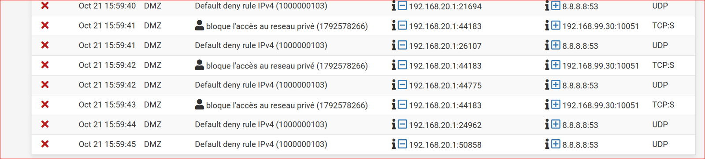

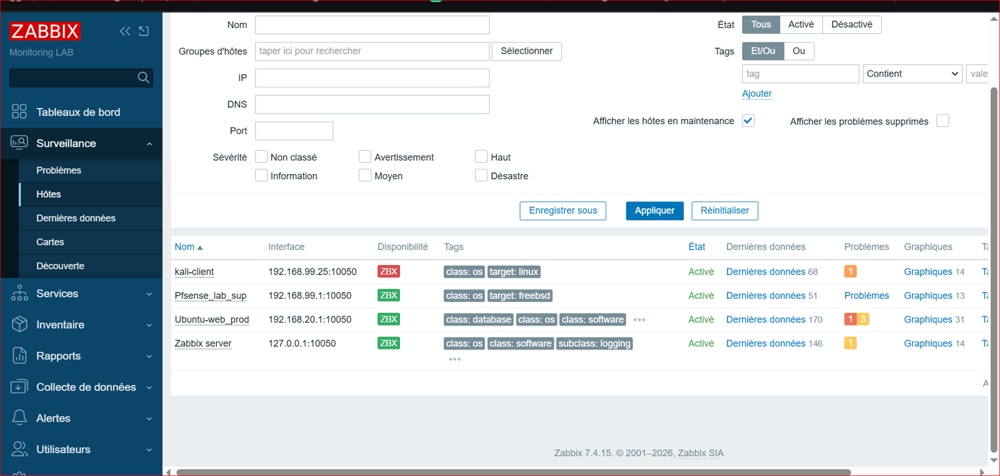

**Ce que j'en retiens** : un durcissement se teste aussi sur ce qu'il ne doit pas casser. Journaliser les blocages permet de retrouver les flux légitimes oubliés.

### 6. Une étendue DHCP sans passerelle et avec un DNS public

**Symptôme** : le poste Marketing obtenait bien une adresse (192.168.99.55), mais `ipconfig /all` affichait une passerelle vide et deux serveurs DNS, 192.168.99.15 et 8.8.8.8.

**Cause** : l'option 003 (Routeur) n'était pas définie dans l'étendue, et l'option 006 contenait un DNS public en plus du contrôleur de domaine.

**Impact** : sans passerelle, le poste ne peut joindre ni Internet, ni la DMZ, ni FileServer. Avec 8.8.8.8, qui ne connaît pas `ecole-gn.gn`, l'ouverture de session et les GPO peuvent échouer de façon aléatoire.

**Résolution** : option 003 réglée sur la VIP 192.168.99.100, option 006 limitée à 192.168.99.15. Les requêtes vers Internet sont transmises par le serveur DNS de l'AD (redirecteurs), jamais par les postes eux-mêmes.

```powershell
Set-DhcpServerv4OptionValue -ScopeId 192.168.99.0 -Router 192.168.99.100 -DnsServer 192.168.99.15 -DnsDomain ecole-gn.gn
```

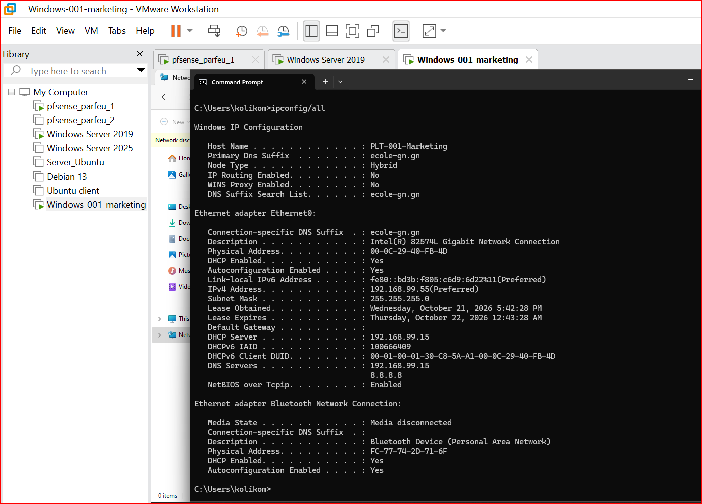

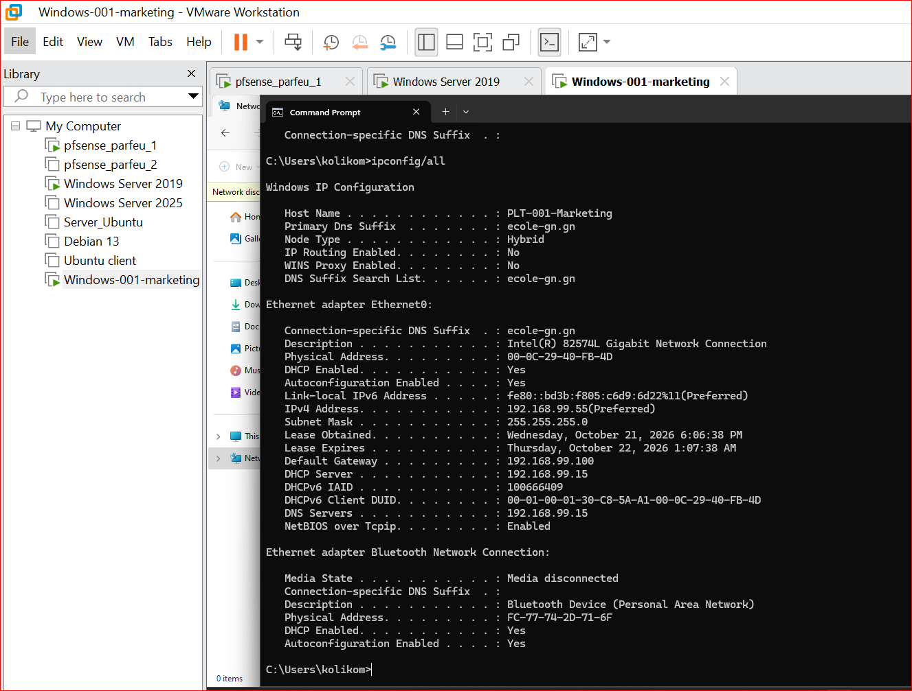

**Ce que j'en retiens** : un bail obtenu ne prouve pas qu'un poste fonctionne ; on contrôle la passerelle et le DNS reçus.

### 7. « Access is denied » en déplaçant une OU

**Symptôme** : impossible de déplacer l'OU Comptabilite dans la nouvelle OU parente, même avec le compte administrateur du domaine.

**Cause** : l'option *Protéger l'objet contre une suppression accidentelle*, cochée par défaut, ajoute une règle de refus « Tout le monde : supprimer ». Pour Active Directory, déplacer un objet revient à le retirer de son emplacement d'origine. Or un refus l'emporte toujours sur une autorisation, y compris pour l'administrateur.

**Résolution** : affichage des fonctionnalités avancées, protection décochée le temps du déplacement, puis remise en place. En PowerShell : `Set-ADOrganizationalUnit -ProtectedFromAccidentalDeletion $false`, puis `Move-ADObject`.

**Ce que j'en retiens** : cette protection évite qu'un glisser-déposer maladroit déplace ou supprime une OU entière. On la retire volontairement, pour une opération précise, puis on la remet.

### 8. Partage du PC hôte refusé : accès invité bloqué

**Symptôme** : depuis les VM, le montage du dossier d'échange du PC hôte échouait avec « *your organization's security policies block unauthenticated guest access* », puis avec les erreurs 86 et 67.

**Cause** : le compte du domaine utilisé dans la VM n'existe pas sur le PC hôte, qui n'est pas membre du domaine. Windows retombait donc sur une connexion invité, sans authentification, que Windows 10 et Windows Server 2019 bloquent par défaut : un partage sans authentification permet à n'importe quelle machine de se faire passer pour un serveur de fichiers.

**Résolution** : connexion avec un compte local du PC hôte, `net use Z: \\HOTE\partage /user:HOTE\compte *`, plutôt que de réactiver l'accès invité. Au passage, un partage non voulu de tout le dossier `C:\Users` de l'hôte a été repéré avec `net share`.

**Ce que j'en retiens** : chaque code d'erreur indique l'étape qui échoue (86 : mot de passe ; 67 : nom de partage ; 1272 : invité bloqué). On ne contourne pas une protection de sécurité, on fournit la bonne authentification.

## Bonnes pratiques appliquées

- Le fichier netplan du serveur DMZ s'appelle `50-cloud-init.yaml` : la configuration réseau de cloud-init est désactivée (`/etc/cloud/cloud.cfg.d/99-disable-network-config.cfg`) pour qu'il ne soit pas réécrit au redémarrage.
- Sauvegarde de la configuration pfSense avant chaque modification des règles.
- Chaque règle porte une description ; une règle dont le compteur d'états reste à 0 est vérifiée.
- Mémoire de l'hôte limitée (16 Go) : seules les VM utiles à chaque scénario sont démarrées.

## Suite du projet

- [x] Segmentation en trois zones et règles inter-zones
- [x] Windows Server 2025 joint au domaine
- [x] DHCP sur le contrôleur de domaine pour le LAN
- [ ] Partages par service sur Windows Server 2025
- [x] Structure Site_Paris : une OU par service (users, computers), OU Admin pour les comptes d'administration
- [x] Script PowerShell : 30 utilisateurs, 5 groupes et rangement des postes depuis deux CSV (exécuté et validé)
- [x] OU Serveurs pour FILESERVER, conteneur Computers vidé
- [ ] GPO : fond d'écran, lecteur réseau, politique de mots de passe
- [ ] Script PowerShell : rapport des comptes inactifs et de l'espace disque

## Auteur

Richard Lamah, administrateur systèmes et réseaux / ingénieur virtualisation · [LinkedIn](https://www.linkedin.com/in/richard-lamah)
